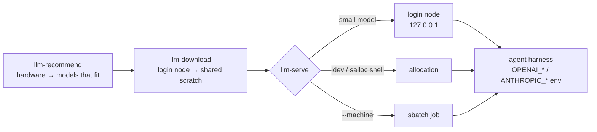

# Open-weight models (EZRA)

The agents can run on an open-weight LLM that you download and serve
yourself, on your workstation or on the cluster, instead of a hosted API.
[EZRA](https://github.com/Awwal41/EZRA) supplies the hardware probe, a
curated model gallery and the downloads; `chimes-agent` sizes the model to
the node, stages the weights on shared scratch and starts the server on a
login node, in an interactive allocation, or as a batch job.



## Install

EZRA is a separate tool (GPL-3.0, Python ≥ 3.10). Install it in its own
environment and tell `chimes-agent` where it is:

```bash
python3 -m venv ~/ezra-venv
~/ezra-venv/bin/pip install "ezra @ git+https://github.com/Awwal41/EZRA"
export CHIMES_EZRA=~/ezra-venv/bin/ezra        # or put it on PATH
```

For serving, install an engine that supports tool calls:

- **llama.cpp `llama-server`** (GGUF, CPU or GPU): a release binary from
  [llama.cpp releases](https://github.com/ggml-org/llama.cpp/releases), or
  build it on the cluster (`cmake -B build && cmake --build build -j`,
  add `-DGGML_CUDA=ON` on a GPU node).
- **vLLM** (safetensors, NVIDIA GPU): `pip install vllm` in a GPU-node
  environment.

## Workflow

```bash
# 1. What fits? This host, or one compute node of a profile.
chimes-agent llm-recommend --for-machine dane

# 2. Download on the login node into the profile's shared scratch.
chimes-agent llm-download --model qwen2.5-14b-instruct --for-machine dane

# 3a. Inside an interactive allocation...
idev -p skx-dev -N 1 -t 02:00:00                   # TACC; or: salloc -N 1 -p pdebug -t 2:00:00
chimes-agent llm-serve --work-dir $SCRATCH/llm --model qwen2.5-14b-instruct

# 3b. ...or as a batch job (dry run first).
chimes-agent llm-serve --work-dir /p/lustre2/$USER/llm --model qwen2.5-14b-instruct --machine dane --walltime-hours 8 --dry-run
chimes-agent llm-serve --work-dir /p/lustre2/$USER/llm --model qwen2.5-14b-instruct --machine dane --walltime-hours 8

# 4. Wait for "ready", then export the client settings it prints.
chimes-agent llm-serve --status --work-dir /p/lustre2/$USER/llm
```

### An EZRA agent profile

EZRA organizes assistants as
[personal agents](https://github.com/Awwal41/EZRA/blob/main/docs/agents.md):
a folder with `agent.yaml` (preferred and fallback models), `prompt.md`
(the system prompt) and `NOTES.md`. This package ships one,
`chimes-assistant`, whose prompt condenses the rules in `CLAUDE.md`.
[`llm-agent`](../commands/llm-agent.md) installs it with models picked for
your node, and `llm-serve --agent` serves from its list:

```bash
chimes-agent llm-agent --for-machine dane
chimes-agent llm-serve --agent chimes-assistant --work-dir /p/lustre2/$USER/llm --machine dane --dry-run
```

To make your own (a lab variant with different priorities, say), copy
`src/agentic_chimes/ezra_agents/chimes-assistant/`, edit `prompt.md`
following EZRA's pattern (role, priorities, typical tasks, style,
boundaries) and pass `--template <folder> --name local/my-chimes`.

A small model can also run on the login node for a quick try
(`llm-serve --work-dir ~/llm --model qwen2.5-3b-instruct`); it is limited
to 4 threads and bound to 127.0.0.1 because login nodes are shared.

Stop the server when you are done (`llm-serve --stop --work-dir ...`): a
batch server holds a whole node until its walltime ends.

## Connect an agent harness

`--status` returns `client.exports`, for example:

```bash
export OPENAI_BASE_URL="http://dane123:41871/v1"
export OPENAI_API_KEY="$(cat /p/lustre2/me/llm/api_key)"
export OPENAI_MODEL="qwen2.5-14b-instruct"
export ANTHROPIC_BASE_URL="http://dane123:41871"           # llama-server only
export ANTHROPIC_AUTH_TOKEN="$(cat /p/lustre2/me/llm/api_key)"
export ANTHROPIC_MODEL="qwen2.5-14b-instruct"
```

- **Claude Code** reads the `ANTHROPIC_*` variables. Recent `llama-server`
  builds implement the Anthropic Messages API; check with
  `curl -s $ANTHROPIC_BASE_URL/v1/messages -H "Authorization: Bearer $ANTHROPIC_AUTH_TOKEN"`
  (a 4xx about the request body means the route exists). With vLLM, put an
  Anthropic-to-OpenAI proxy such as LiteLLM in between. The skills,
  subagents and approval hook in `.claude/` keep working.
- **Cline**, the tool-using agent EZRA pairs with (`ezra cline`, EZRA Grid):
  run the `client.cline_auth` line once, then
  `cline -P openai-compatible -m <model> "..."`. Put the agent's
  `prompt.md` in `.clinerules` so Cline follows it.
- **Other OpenAI-compatible harnesses** (OpenCode, Aider, ...) use the
  `OPENAI_*` variables. They read `CLAUDE.md` or `AGENTS.md` to varying
  degrees, and they do not run `.claude/hooks/approval_gate.py`: turn on
  their own command-approval prompts.

From a laptop, use the `ssh_tunnel` line from `--status` and point the
client at `http://127.0.0.1:<port>`.

## What to expect

- Larger is better for agents. Models of 14B and below handle single stage
  calls and job monitoring; long multi-phase studies need a stronger model
  (30B+ on a GPU node) and close supervision of every approval.
- Context matters: the agent system prompt and skills take tens of
  thousands of tokens. Keep `--ctx-size` at 32k or more; the recommender
  counts the KV cache against memory for that reason.
- CPU inference works on a full node but is several times slower than a
  GPU; long agent turns will take minutes.
